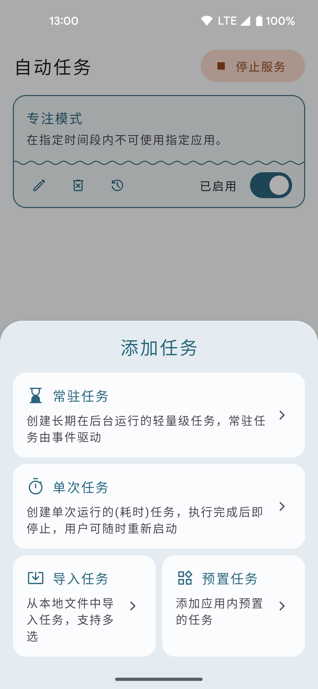
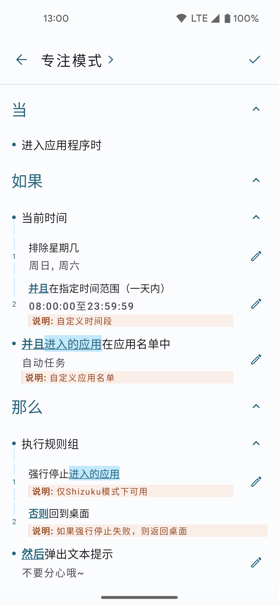
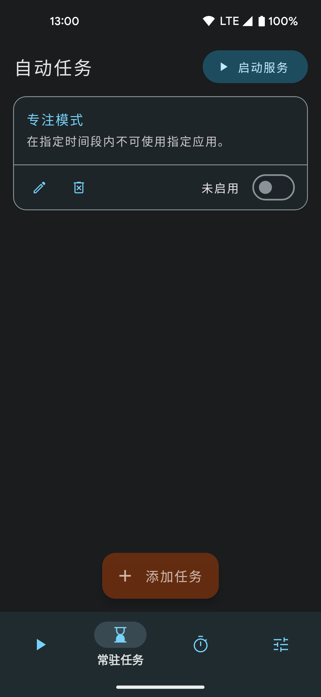
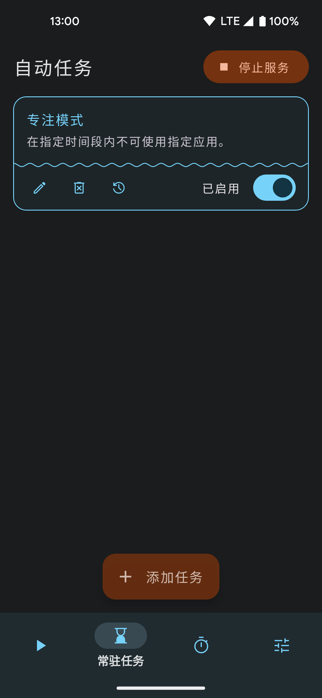

# 自动任务® · AutoTask

一款支持 [Shizuku](https://github.com/RikkaApps/Shizuku) 与无障碍服务的 Android 自动化工具。用可视化规则拼出「当…时 / 如果…那么…」的流程，交给手机自己执行。

<p align="center">
  
  
  
  
</p>

> **关于本项目**：本项目是原作者 **xjunz** 的开源项目 [xjunz/AutoTask](https://github.com/xjunz/AutoTask)（Apache-2.0）的后续维护版。原作者已停止维护，自 1.5.0 起本仓库**不再公开源代码**，只发布安装包；所有基础设计归功于原作者，本仓库是在其成果之上的修复与扩展。
>
> 本版的大量新能力（屏幕找图、手动触发悬浮球、新的触发条件等）来自群友 **🍀** 维护的功能分支，特此致谢。

> **包名与共存**：安装包名为 `top.xjunz.tasker.beta`，可以与旧版（`top.xjunz.tasker`，≤ 1.4.7r56）**同时安装、互不干扰**；两者的任务数据与权限各自独立，卸载其一不影响另一个。

## 下载

前往 [**Releases**](https://github.com/chenyubo10665/AutoTask/releases) 下载最新版。

| 安装包 | 适用设备 |
| --- | --- |
| [`AutoTask-1.6.9.2-universal.apk`](https://github.com/chenyubo10665/AutoTask/releases/download/v1.6.9.2/AutoTask-1.6.9.2-universal.apk) | 通用包，四种 ABI 合一，体积最大 |
| [`AutoTask-1.6.9.2-arm64-v8a.apk`](https://github.com/chenyubo10665/AutoTask/releases/download/v1.6.9.2/AutoTask-1.6.9.2-arm64-v8a.apk) | **推荐**，绝大多数 2016 年后的 64 位手机 |
| [`AutoTask-1.6.9.2-armeabi-v7a.apk`](https://github.com/chenyubo10665/AutoTask/releases/download/v1.6.9.2/AutoTask-1.6.9.2-armeabi-v7a.apk) | 32 位老机型 |
| [`AutoTask-1.6.9.2-x86_64.apk`](https://github.com/chenyubo10665/AutoTask/releases/download/v1.6.9.2/AutoTask-1.6.9.2-x86_64.apk) / [`-x86.apk`](https://github.com/chenyubo10665/AutoTask/releases/download/v1.6.9.2/AutoTask-1.6.9.2-x86.apk) | 模拟器（BlueStacks、MuMu 等） |

系统要求：Android 7.0（API 24）及以上，目标 API 36。

## 1.6.9.2 更新摘要

修一个点「启用悬浮助手」时弹出的裸 NullPointerException。

在单次任务页或编辑器里唤起悬浮助手、点「**启用**」后，会弹出「发生错误」框：

```
java.lang.NullPointerException
  at java.util.Objects.requireNonNull(Objects.java:203)
  at rikka.shizuku.ShizukuBinderWrapper.<init>
```

根因：开启无障碍服务走的是 `SystemServiceHelper.getSystemService("settings")`，这个接口在低版本
系统上会返回 **null**（原代码里本来就留了一句同样的 TODO）。把 null 交给 `ShizukuBinderWrapper`，
它的构造函数直接 `requireNonNull`，于是抛异常。

修法：settings 服务拿不到时，不再硬套 `ShizukuBinderWrapper`，改为回退到 Shizuku 的 `newProcess`
执行同一条 `settings put secure ...` 命令 —— 这条路径在本机（Android 7.1.2 + Shizuku）已稳定可用，
`A11yAutoEnabler` 一直用它。两者都不可用时给出明确失败提示，不再是裸 NPE。

- 版本 1.6.9.1(85) → 1.6.9.2(86)。

## 1.6.9.1 更新摘要

修一个会让 Shizuku 服务进程**整个挂掉**的崩溃。

在 Shizuku 模式下，任务执行到「**弹出文本提示**」或「**绘制控件边界**」时，整个远程进程会直接退出：

```
FATAL EXCEPTION IN SYSTEM PROCESS: ShizukuAutomatorThread
java.lang.NoSuchFieldException: No field mClassLoader in class Landroid/app/ContextImpl;
```

现象是服务看着还在、常驻任务却不再响应。根因是叠加窗初始化时无条件反射平台私有字段
`ContextImpl.mClassLoader`，而该字段在 Android 7.x 上并不存在，异常穿透 lazy 初始化器把整个 shell 进程带走。

修法两层：该字段改为「有则用、无则跳过」并沿 `ContextWrapper` 链逐层查找；叠加窗 inflate **直接使用本应用
自己的 ClassLoader**（`ThemedWindowContext.getClassLoader()`），不再依赖任何平台私有字段。另给
`TYPE_SECURE_SYSTEM_OVERLAY` 加了降级链（它同样是隐藏字段）。

- 版本 1.6.9(84) → 1.6.9.1(85)。

## 1.6.9 更新摘要

两个界面问题修复。

1. **修复对话框大标题显示错误**：任务编辑器里"放弃更改"确认框的标题曾显示成「感谢您的支持」。
   原因是 `makeSimplePromptDialog` 的 `inline` 默认参数 `title = R.string.tip` 被内联成数字资源 ID，
   这里取到了不相干的字符串。改为在调用点显式传 `title`。
2. **点击当前分类图标回到顶部**：在任意带分类的页面，点击你当前所在的那个分类图标，
   列表会滚回顶部；切换分类仍是正常切换。用 `setOnItemReselectedListener` 实现
   （Material 只在选中项变化时回调 `onItemSelected`，点已选中项走 reselect）。

- 版本 1.6.8(83) → 1.6.9(84)。

## 1.6.8 更新摘要

补齐原闭源版本的 **7 项能力**，并让旧版任务导入真正可用。

**新增能力**

1. 充电方式细分（交流 AC / USB / 无线 / 充电底座 / 未连接电源）
2. 可见窗口判断
3. 查找控件时可包含不可见控件
4. 优化查找速度（命中即停）
5. 任务覆盖导入（重名时询问覆盖或跳过）
6. 本页面内只执行一次（新规则类型）
7. 从最近任务中隐藏

**旧版任务导入**

来自旧版本的 11 个预置任务现在全部可以转换导入，此前一个都成功不了。修掉 5 个独立缺陷：
转换时规则节点根本没被改写、控制流的 relation 约束、applet id 需要重映射、参数个数不一致
导致越界、同一参数同时有值与引用导致编辑器崩溃。转换后会把缺失与需确认的步骤写进任务描述。

- 版本 1.6.6(81) → 1.6.8(83)。

## 1.6.0 更新摘要

### ✨ AI 生成任务

任务编辑器右上角新增「AI 生成」按钮（✨），用自然语言描述想要的规则，AI 会结合当前任务已有的规则（可选连带读取最近运行记录）给出方案：

- 结果先以**概览卡片**展示标题（**可直接修改**）、方案说明与逐条规则，点「满意」后才应用到编辑器
- 不满意可就地写反馈让它重新生成，最多 3 轮
- 应用后只替换标题与说明等内容，**不会自动保存**，仍需你手动点保存

### 🔑 AI 服务配置

「更多」→「AI 配置」中填写 API Key、接口地址（OpenAI 兼容，留空默认 `https://api.openai.com/v1`）、模型与思考强度：

- 支持一键「获取可用模型」与「测试连接」
- 思考强度对应 temperature 0.2 / 0.5 / 0.8
- 可开关「允许 AI 读取运行记录」，Key 只保存在本机，不上传任务数据

### 🐞 修复

- 修复每次更新后首启庆祝窗**正文不显示**的问题（内容区域高度被压成 0）
- 修复 AI 配置页按钮渲染成色块的问题

- 版本 1.5.7r487(65) → 1.6.0(72)。

## 1.5.7r487 更新摘要

### 🎉 回归经典：更新完成礼炮 + 本版更新内容

之前的版本里，原作者更新服务器还在的时候，每次更新完都会弹一个窗展示本次更新内容，并放礼炮庆祝；服务器下线后这个弹窗变成空白。

本次把「更新内容 + 礼炮」**内置进安装包**，恢复此仪式：

- 更新完成后**首次启动**弹窗展示本版更新内容，并放礼炮（confetti）庆祝
- 更新内容已打包进 APK，**不再依赖任何服务器**，永远不会再变空白
- 每个版本只在升级后弹一次

其他：多线程分段下载、下载进度/速度显示、竖屏内容偏上修复（随本版一并包含）。

- 版本 1.5.7(64) → 1.5.7r487(65)。

## 1.5.7 更新摘要

### 提速：应用内更新下载改为多线程分段下载

- 探测到 GitHub 支持 Range 分段后，**4 线程并发**下载文件各段；真机实测 4 MB 更新包从约 48 秒降到约 18 秒
- 服务器不支持分段时自动退回单线程流式下载
- 每个分段独立重试（最多 3 次）并**断点续传**：弱网下某一段连接超时不再导致整个下载失败

### 新增：下载进度与速度显示

- 下载弹窗显示**进度条 + 百分比 + 实时速度 + 已下载/总大小**（如 `50% · 1.03 MB/s · 2.03 MB / 4.05 MB`）
- 新增**取消按钮**，可随时中断并清理未完成的文件

- 版本 1.5.6(63) → 1.5.7(64)。

## 1.5.6 更新摘要

### 新增：应用内直接下载并安装更新

检测到新版本后不再跳转浏览器：点「下载」直接在应用内下载安装包，完成后自动调起系统安装器。

- **下载前按设备 CPU 架构自动选包**（arm64-v8a / armeabi-v7a / x86_64 / x86，选不到退 universal），只下载你需要的包（约 4~6 MB），不用在浏览器里挑
- 需要一次性授予「安装未知来源应用」权限，应用内会引导到授权页
- 真机（Android 7.1.2）完整走通：检测 → 下载 → 拉起安装器 → 覆盖升级成功、数据保留

### 修复：竖屏四个主界面内容偏上、滚不到顶

1.5.5 的横屏适配用了已废弃的 `systemUiVisibility` 接口，它会清掉 edge-to-edge 标记，导致顶部标题栏拿不到状态栏占位，任务列表第一项被标题栏压住、也滚不回顶部。已改用 `WindowInsetsControllerCompat` 控制导航栏显隐，竖屏恢复正常。

- 版本 1.5.5(62) → 1.5.6(63)。

## 1.5.5 更新摘要

### 新增：GitHub Issues 反馈入口

之前点「反馈 & 交流」只有「加群」和「邮件」（邮件因未配邮箱无法使用）。现在加了 **`GitHub Issues`** 项，点击直接跳转仓库的 Issues 页面，可上传截图、附加日志、描述问题。

### 新增：横屏沉浸式导航栏 + 侧边标签栏

横屏使用时（平板、支架、旋转手机至宽屏）：

- **底部三大金刚键自动隐藏**（上滑调出），内容区域更高
- **底部标签栏移到屏幕左侧**成一列图标（`NavigationRailView`），单手拇指就能碰到
- 每个标签的数字角标照常生效
- 旋转回竖屏立即恢复底部三标签 + 底部导航键

竖屏样式无变化。（**更正**：本版实际引入了竖屏内容偏上的回归，已在 1.5.6 修复。）

### 包含 1.5.4 的修复：升级后首次启动误报「服务注册失败」

（1.5.5 完全包含 1.5.4 的改动，从 1.5.3 或更早版本升级的用户可直接跳到本版。）

- 版本 1.5.4(61) → 1.5.5(62)。

## 1.5.4 更新摘要

**本版重点：修复升级后首次启动误报「服务注册失败」。**

- 症状：从旧版升级安装后第一次打开，会弹「本应用不能与其他版本的同类自动化应用（如另一版自动任务、Thanox 的 Automation 功能）同时运行」，但其实并没有装第二个自动化应用，重启一次就自己好了。
- 这是**误报**。一是升级瞬间 Shizuku 会注销旧版的特权服务（版本号对不上），新进程刚起来去绑定会拿到失效 binder 或撞上尚未释放的 UiAutomation 注册，下一次连接就正常；二是旧代码用 `contains("registered")` 判断冲突，**任何**含这个词的异常都会被翻译成「另一个自动化应用在运行」。
- 现在判断改为精确匹配 `UiAutomationService` + `already registered`，只有真被别的自动化应用占着才提示那条冲突说明，其余错误如实显示。
- 升级后首次绑定的瞬态失败改为**自动重试**（最多 3 次），几乎都是一次就成功，用户看不到弹窗、服务直接可用。
- 版本 1.5.3(60) → 1.5.4(61)。

## 1.5.3 更新摘要

- **修复：选择规则界面竖屏比横屏少一项**。购物车收起时只给右侧选项列表加了底部内边距，左侧分类栏没加，竖屏下「权限控制」「通知操作」被挡住；现在两侧都留出购物车高度。
- **新增：规则搜索**。选择规则界面顶部可搜，**跨所有分类**实时过滤，不区分大小写，也匹配 Shizuku / API 级别等标记；无结果时给出提示，点 ✕ 清空回到原分类。
- 去掉右侧列表重复的顶部内边距，横屏顶部不再有多余空档。
- 版本 1.5.2(59) → 1.5.3(60)。

## 1.5.2 更新摘要

**本版重点：更新检查改为从本仓库的 GitHub Releases 获取。**

- 原来请求原作者早已停用的服务器（`api.bq04.com`），中间还被改成过"直接显示无更新"的占位实现，等于更新检查完全失效。
- 现在启动时与手动点「检查更新」都会读取 `releases/latest`，**按设备架构自动选包**（arm64-v8a / armeabi-v7a / x86 / x86_64，选不到退 universal）。
- 版本比较改为按版本名（数字段比较，`1.5.10 > 1.5.9`），不再依赖 versionCode。
- 弹窗「下载」直接打开适合你机型的 APK 直链；没有附件时退回 Release 页面。
- 以后有新版本应用自己就能发现并下载，不用再等群里通知。

其他修复：

- **Android 7.x 启动闪退**：`NotificationChannel` 等 API 26 接口未做版本判断，服务创建即抛 `NoClassDefFoundError`；现已统一走兼容封装。
- **Shizuku 服务启动弹"发生错误"**：`coroutine-ui-automator` 单独开混淆把 `uiautomator` 模块整个收缩掉，release 包里 0 个类；已关闭库级混淆并补齐反射 keep。

## 1.5.1 更新摘要

同步群友 🍀 2026-10-31 的进度（12 个提交 + 工作区改动），主要是日志体系与性能方面的工作：

- **新增「清理后台」硬件操作**：枚举第三方应用后逐个 `force-stop`（走 Shizuku 特权 binder），支持**排除应用白名单**。
- **日志系统重构**：主进程与特权进程日志统一写入应用专属目录的 `trace.log`（特权进程经 binder IPC 转发），支持 logcat 镜像；反馈时直接附这一个文件即可。
- **日志降噪**：事件门未命中、任务整体成功时不再输出详细规则日志，只在失败时保留。
- **找图提速**：改为「先用所有缩放尺度只搜选定区域，区域全失败才做全屏」，避免每个尺度都跑一次全屏匹配（原来最坏累积约 6 秒）。
- 修复：清理后台不生效 / 因 `am kill-all` 杀掉本应用特权进程而崩溃、sui 模式误提示未安装 Shizuku、导入旧版任务文件时提示含糊、分享文件时 FileProvider 异常带崩界面、「关于」页关闭日志开关崩溃。
- 从 1.5.0 升级直接覆盖安装即可（同包名同签名），无需卸载。

## 1.5.0 更新摘要

这一版把群友分支的全部功能并了进来（**共 83 条新规则**），并修掉一批崩溃与重复执行问题，主要变化：

- **找图（屏幕模板匹配）**：截屏框选模板 → 在屏幕上定位 → 坐标可被后续点击/等待规则引用；支持相似度、截图前延迟、多尺度金字塔与双重校验（MAD / NCC），误匹配大幅减少。
- **新触发条件**：屏幕点亮/熄灭、锁屏/解锁、电量变化、应用安装/卸载、**连接指定蓝牙**、**断开指定蓝牙**、**当处于指定应用内**。
- **手动触发悬浮球**：每个任务一颗悬浮球，靠右吸附自动排列，点一下即执行（含大小与吸附设置）。
- **音量控制**：可用 shell 通道精确设置媒体/铃声/通知音量，Android 9+ 兼容。
- **悬浮助手增强**：组件属性补全（宽高、位置、层级、索引等）、新增选项默认不勾选、新增截图模式。
- **日志**：日志开关、本地写入、特权进程日志落盘与自动清理，反馈时可附日志。
- **体积**：移除未使用的原生库，安装包从 ~17 MB 降到 ~6 MB；发布版启用代码混淆。
- **稳定性**：修复 Shizuku + 无障碍双模式任务重复执行、截图确认闪退、悬浮球拖动/吸附错位、前台服务超时、任务暂停越界、空节点崩溃等。

完整变更见 [Release 说明](https://github.com/chenyubo10665/AutoTask/releases)。

## 主要功能

- 两种工作模式：**Shizuku**（特权 shell / UiAutomation）与**无障碍服务**，可随时切换
- 常驻任务（事件触发）与一次性任务，支持手势录制、布局树审查、坐标拾取
- 事件驱动 + 协程，长时间任务不占 CPU，后台常驻省电
- Material 3 界面，支持深色模式、Edge-to-Edge
- 规则覆盖：应用与页面、控件层级、文本、通知、时间、连接状态、系统状态、文件与剪贴板、Shell 命令、音量与硬件开关等

## 安装说明

1. 按机型下载对应 ABI 的 APK（不确定就选 universal）。
2. 允许「安装未知来源应用」后安装。
3. 首次启动按引导选择工作模式：Shizuku 需先在手机装好 Shizuku 并授权；无障碍模式需在系统设置里开启「自动任务」的无障碍服务。

注意事项：

- 本版是**新包名**的应用：装好后需要在 Shizuku / 无障碍里重新授权一次，之前旧版里的任务不会自动迁移过来。
- 安装包使用**调试证书**签名后分发，方便自用与测试；若你之前装过其他渠道的同名应用（签名不同），需要先卸载再安装。
- 覆盖升级请直接安装新版，不要在旧版运行时强制停止服务后再装。

## 使用须知

- 本项目仅供学习交流使用，**禁止用于商业用途或非法用途**。
- 自动化可能影响其他应用正常运行，请自行评估风险。
- 问题反馈请到 [Issues](https://github.com/chenyubo10665/AutoTask/issues) 留言（附机型、系统版本与复现步骤）。

## 版权与协议

- 原始项目：[xjunz/AutoTask](https://github.com/xjunz/AutoTask)，作者 **XJUNZ**，Apache License 2.0，`Copyright 2023 XJUNZ`。
- 本仓库的 1.5.0 及之后的修改与打包：由 **chenyubo10665** 与群友 **🍀** 维护，`Copyright 2026 chenyubo10665`。
- 依据 Apache-2.0，保留原版权与许可声明，完整协议见 [LICENSE](LICENSE)。本仓库不含源代码，仅分发编译产物。
