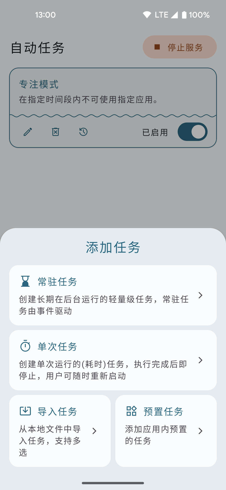
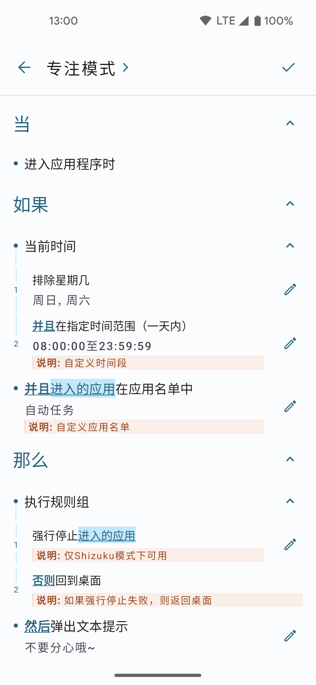
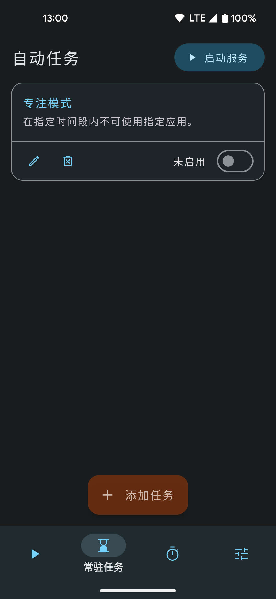
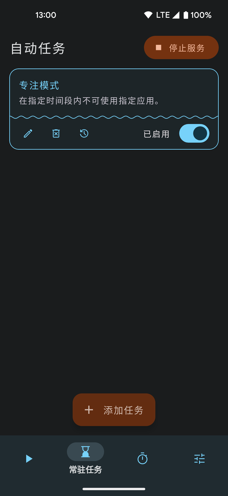

# 自动任务® · AutoTask

一款支持 [Shizuku](https://github.com/RikkaApps/Shizuku) 与无障碍服务的 Android 自动化工具。用可视化规则拼出「当…时 / 如果…那么…」的流程，交给手机自己执行。

  
  
  
  

> **关于本项目**：本项目是原作者 **xjunz** 的开源项目 [xjunz/AutoTask](https://github.com/xjunz/AutoTask)（Apache-2.0）的后续维护版。原作者已停止维护，自 1.5.0 起本仓库**不再公开源代码**，只发布安装包；所有基础设计归功于原作者，本仓库是在其成果之上的修复与扩展。
>
> 本版的大量新能力（屏幕找图、手动触发悬浮球、新的触发条件等）来自群友 **🍀** 维护的功能分支，特此致谢。

> **包名与共存**：安装包名为 `top.xjunz.tasker.beta`，可以与旧版（`top.xjunz.tasker`，≤ 1.4.7r56）**同时安装、互不干扰**；两者的任务数据与权限各自独立，卸载其一不影响另一个。

## 下载

前往 [**Releases**](https://github.com/chenyubo10665/AutoTask/releases) 下载最新版。

| 安装包 | 适用设备 |
| --- | --- |
| `AutoTask-1.5.0-universal.apk` | 通用包，四种 ABI 合一，体积最大 |
| `AutoTask-1.5.0-arm64-v8a.apk` | **推荐**，绝大多数 2016 年后的 64 位手机 |
| `AutoTask-1.5.0-armeabi-v7a.apk` | 32 位老机型 |
| `AutoTask-1.5.0-x86_64.apk` / `-x86.apk` | 模拟器（BlueStacks、MuMu 等） |

系统要求：Android 7.0（API 24）及以上，目标 API 36。

## 1.5.0 更新摘要

这一版把群友分支的全部功能并了进来（**共 83 条新规则**），并修掉一批崩溃与重复执行问题，主要变化：

- **找图（屏幕模板匹配）**：截屏框选模板 → 在屏幕上定位 → 坐标可被后续点击/等待规则引用；支持相似度、截图前延迟、多尺度金字塔与双重校验（MAD / NCC），误匹配大幅减少。
- **新触发条件**：屏幕点亮/熄灭、锁屏/解锁、电量变化、应用安装/卸载、**连接指定蓝牙**、**断开指定蓝牙**、**当处于指定应用内**。
- **手动触发悬浮球**：每个任务一颗悬浮球，靠右吸附自动排列，点一下即执行（含大小与吸附设置）。
- **音量控制**：可用 shell 通道精确设置媒体/铃声/通知音量，Android 9+ 兼容。
- **悬浮助手增强**：组件属性补全（宽高、位置、层级、索引等）、新增选项默认不勾选、新增截图模式。
- **日志**：日志开关、本地写入、特权进程日志落盘与自动清理，反馈时可附日志。
- **体积**：移除未使用的原生库，安装包从 ~17 MB 降到 ~6 MB；发布版启用代码混淆。
- **稳定性**：修复 Shizuku + 无障碍双模式任务重复执行、截图确认闪退、悬浮球拖动/吸附错位、前台服务超时、任务暂停越界、空节点崩溃等。

完整变更见 [Release 说明](https://github.com/chenyubo10665/AutoTask/releases)。

## 主要功能

- 两种工作模式：**Shizuku**（特权 shell / UiAutomation）与**无障碍服务**，可随时切换
- 常驻任务（事件触发）与一次性任务，支持手势录制、布局树审查、坐标拾取
- 事件驱动 + 协程，长时间任务不占 CPU，后台常驻省电
- Material 3 界面，支持深色模式、Edge-to-Edge
- 规则覆盖：应用与页面、控件层级、文本、通知、时间、连接状态、系统状态、文件与剪贴板、Shell 命令、音量与硬件开关等

## 安装说明

1. 按机型下载对应 ABI 的 APK（不确定就选 universal）。
2. 允许「安装未知来源应用」后安装。
3. 首次启动按引导选择工作模式：Shizuku 需先在手机装好 Shizuku 并授权；无障碍模式需在系统设置里开启「自动任务」的无障碍服务。

注意事项：

- 本版是**新包名**的应用：装好后需要在 Shizuku / 无障碍里重新授权一次，之前旧版里的任务不会自动迁移过来。
- 安装包使用**调试证书**签名后分发，方便自用与测试；若你之前装过其他渠道的同名应用（签名不同），需要先卸载再安装。
- 覆盖升级请直接安装新版，不要在旧版运行时强制停止服务后再装。

## 使用须知

- 本项目仅供学习交流使用，**禁止用于商业用途或非法用途**。
- 自动化可能影响其他应用正常运行，请自行评估风险。
- 问题反馈请到 [Issues](https://github.com/chenyubo10665/AutoTask/issues) 留言（附机型、系统版本与复现步骤）。

## 版权与协议

- 原始项目：[xjunz/AutoTask](https://github.com/xjunz/AutoTask)，作者 **XJUNZ**，Apache License 2.0，`Copyright 2023 XJUNZ`。
- 本仓库的 1.5.0 及之后的修改与打包：由 **chenyubo10665** 与群友 **🍀** 维护，`Copyright 2026 chenyubo10665`。
- 依据 Apache-2.0，保留原版权与许可声明，完整协议见 [LICENSE](LICENSE)。本仓库不含源代码，仅分发编译产物。
